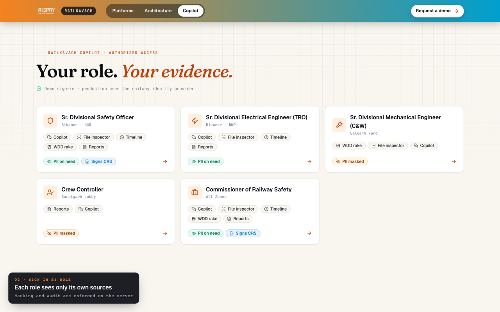
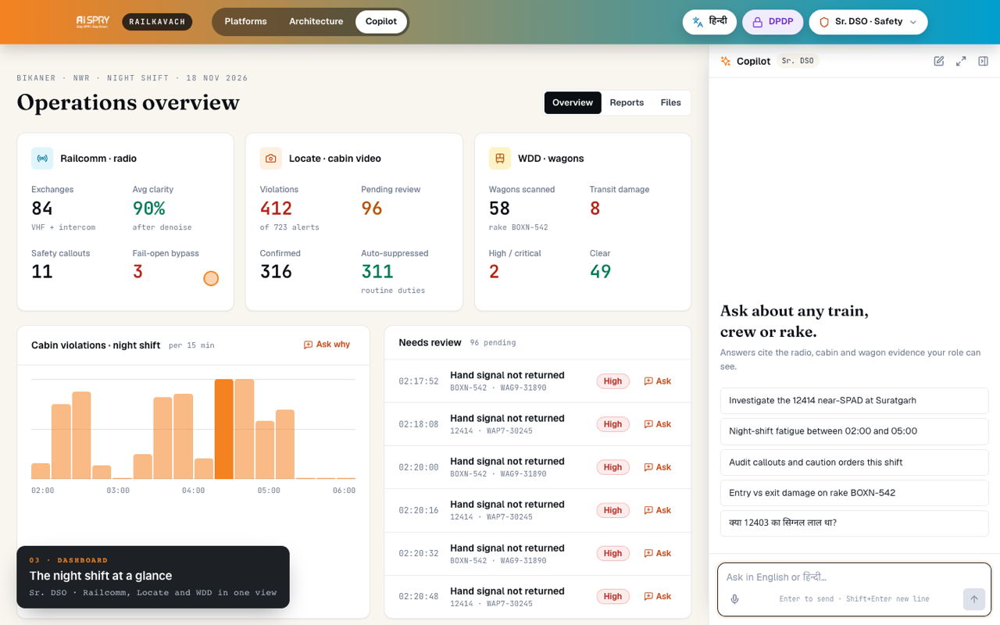
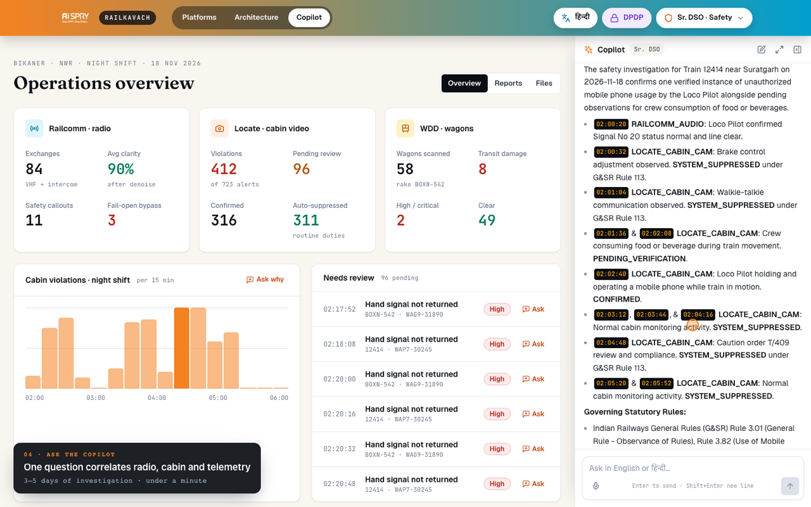
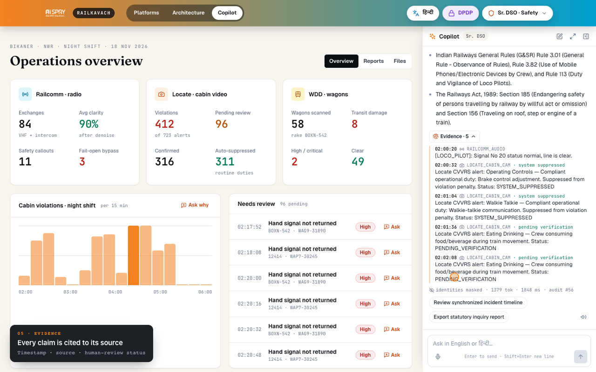
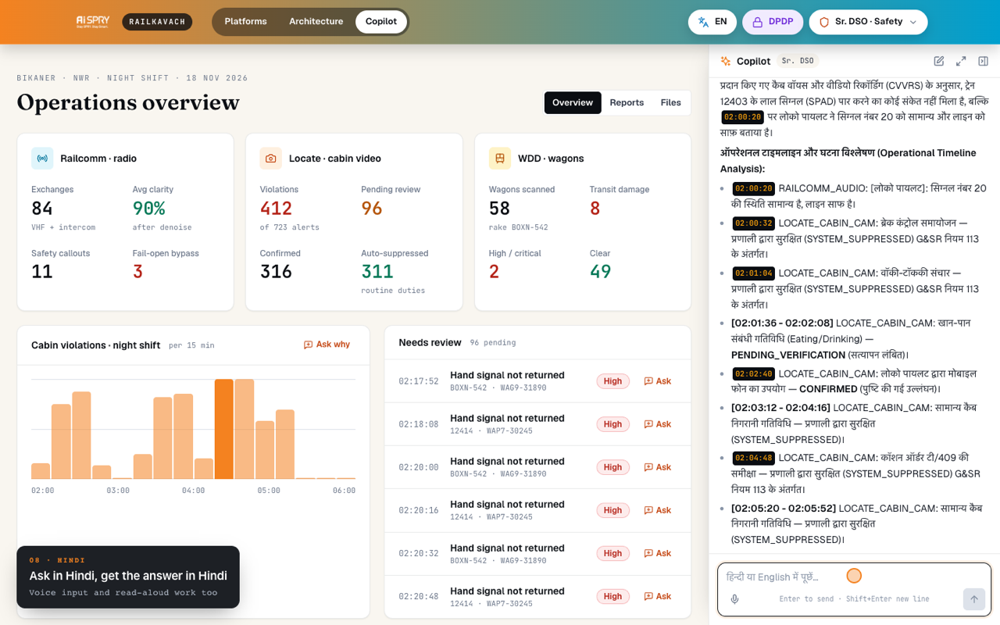
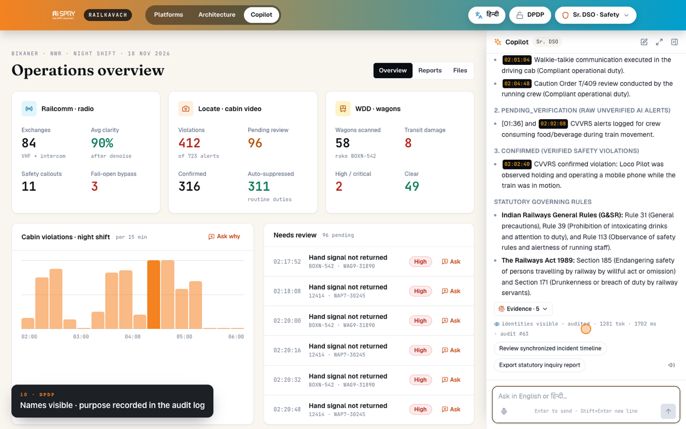
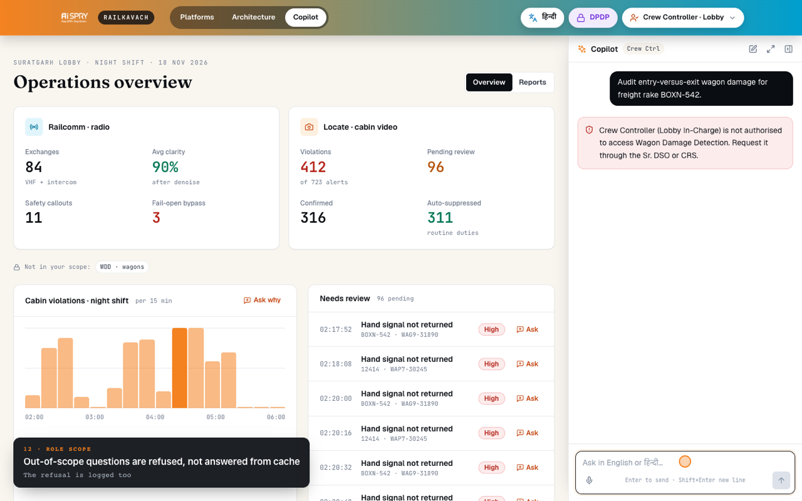
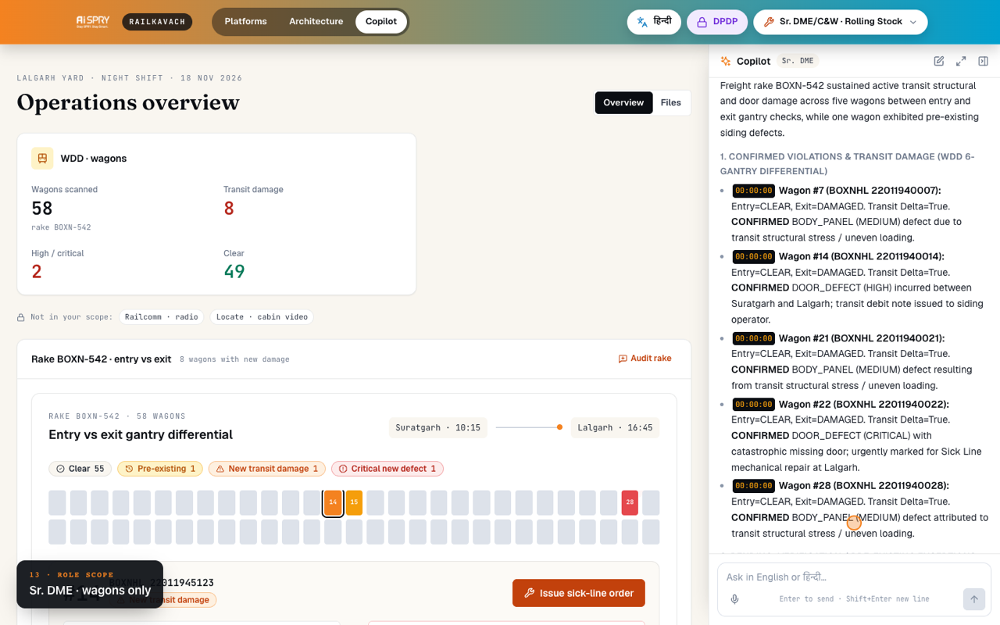

# RailKavach Copilot — demo

A recorded walkthrough (Playwright) of what railway staff can ask and how they see the answers.

```bash
cd demo
npm install
npm run record        # against http://localhost:8000 (backend serving frontend/out)
npm run record:live   # against Cloud Run
HEADED=1 npm run record   # watch it run
```

Output in `demo/output/` (not committed): `railkavach-copilot-demo.webm` (~2:40, 1440×900), `shots/` for every step, `chapters.md` with timestamps.

---

## Who can ask what

The server decides from the role's data scope. The answers below come from the live service.

| Question | Needs | Sr. DSO | Sr. DEE | Sr. DME | Crew Ctrl | CRS |
|---|---|:-:|:-:|:-:|:-:|:-:|
| Investigate the 12414 near-SPAD at Suratgarh | Radio · Cabin · Telemetry | ✅ | ✅ | ⛔ | ⛔ | ✅ |
| क्या 12403 का सिग्नल लाल था? | Radio · Cabin · Telemetry | ✅ | ✅ | ⛔ | ⛔ | ✅ |
| Night-shift fatigue between 02:00 and 05:00 | Cabin | ✅ | ✅ | ⛔ | ✅ | ✅ |
| Audit callouts and caution orders this shift | Radio | ✅ | ✅ | ⛔ | ✅ | ✅ |
| Explain a cabin alert (dashboard **Ask**) | Cabin | ✅ | ✅ | ⛔ | ✅ | ✅ |
| Entry vs exit damage on rake BOXN-542 | Wagons | ✅ | ⛔ | ✅ | ⛔ | ✅ |

⛔ = refused, with the reason, and logged in the audit log. A refusal is never swapped for cached data.
Identities are masked for every role by default. Sr. DSO, Sr. DEE and CRS can unmask them by declaring an inquiry; that is audited too.

## Ways to ask

- **Suggested questions** when the chat is empty, filtered to the role
- **Ask** on any dashboard row or section (review queue, radio exchanges, chart, incident, rake)
- **Type** in English or हिन्दी · **voice** input · **follow-up** chips under each answer
- `⌘I` / `Ctrl+I` opens or closes the chat · `Esc` collapses · widen for long reports

## How the answer looks

| | |
|---|---|
|  **Sign in by role** |  **Dashboard + chat** |
|  **Answer** — verdict, timeline with time chips, statutory rules |  **Evidence** — every citation, source and review status · masking · audit # |
|  **Hindi** in, Hindi out |  **DPDP** — identities visible only under a declared inquiry |
|  **Out of scope** — Crew Controller asking about wagons |  **Sr. DME** — wagons only |

## Chapters

```
00:00  01 Landing
00:10  02 Sign in by role
00:17  03 Dashboard
00:37  04 Ask the Copilot
00:47  05 Evidence
00:54  06 Follow up
01:02  07 Ask from the dashboard
01:10  08 Hindi
01:24  09 Workspace (widen / collapse)
01:32  10 DPDP masking
01:49  11 Reports
01:54  12 Role scope · Crew Controller
02:21  13 Role scope · Sr. DME
```
