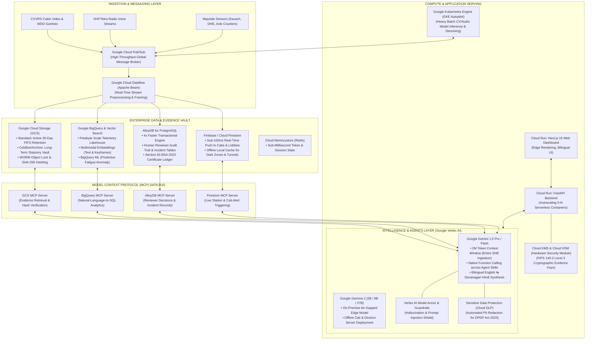

# RailKavach Copilot — Google Cloud Enterprise Backend Architecture

> **Platform:** RailKavach AI Platform & RailKavach Copilot  
> **Target Scale:** Enterprise National Deployment across 17 Zonal Railways & 68 Operating Divisions  
> **Deployment Suite:** Google Cloud Enterprise Data & AI Stack (GCP Sovereign Indian Regions: `asia-south1` Mumbai & `asia-south2` Delhi)  
> **Core Paradigms:** Serverless Compute, Pluggable ROCP Connectors, Model Context Protocol (MCP) Bus, and Immutable Cryptographic Governance

---

## 1. Executive Architecture Overview

RailKavach Copilot is designed to scale from local divisional proofs-of-concept (such as North Western Railway with 11,354 audio files and 3.68M transcript lines) to the entire Indian Railways network (handling tens of petabytes of continuous 1080p CVVRS cabin video, high-speed wayside gantry imagery, radio voice streams, and millisecond IoT sensor events).

The architecture unifies Google Cloud's compute, analytics, storage, database, and generative AI services into a cohesive, secure, and sovereign railway safety ecosystem.

---

## 2. Product-by-Product Google Cloud Architecture Breakdown

### 2.1 Model Context Protocol (MCP) — The Google Cloud Data Bus
The architecture uses **Model Context Protocol (MCP)** servers to allow Gemini and autonomous agents to query, inspect, and manipulate Google Cloud resources dynamically without rigid API hardcoding:

* **`gcs-mcp-server`:** Dispatches agents to fetch audio waveforms, crop high-resolution wagon photos from gantries, and verify SHA-256 hashes directly inside GCS buckets.
* **`bigquery-mcp-server`:** Translates natural-language questions (*"Show all trains on Suratgarh section in October where brake pipe pressure dropped below 4.8 kg/cm²"*) into optimized BigQuery SQL and returns structured records.
* **`alloydb-mcp-server`:** Manages transactional locks and queries for human reviewer validation queues (`CONFIRMED` / `PENDING_VERIFICATION`).
* **`firestore-mcp-server`:** Subscribes agents to live cab events and pushes real-time safety briefs directly to crew lobbies.

---

### 2.2 Operational Databases: AlloyDB vs. Firebase Firestore

| Google Cloud Product | Architectural Role in RailKavach | Scaling & Operational Advantage |
| :--- | :--- | :--- |
| **AlloyDB for PostgreSQL** | **Primary Relational Core & Cryptographic Audit Vault** | • Fully managed, PostgreSQL-compatible database offering **4x faster transactional throughput** than standard PostgreSQL. • Stores incident registers, disciplinary charge sheets, reviewer identity audits, and Section 63 BSA 2023 electronic evidence chains. • Built-in columnar engine for instant analytical queries across millions of duty records. |
| **Firebase / Cloud Firestore** | **Real-Time Locomotive Alert & Lobby Sync** | • Serverless NoSQL document database with **sub-100ms real-time listener updates**. • Synchronizes live cab alerts between running locomotives and the Division Safety Officer (Sr. DSO) console. • Handles offline persistence on locomotive mobile devices when trains enter tunnels or dark zones, syncing automatically upon network recovery. |
| **Cloud Memorystore (Redis)** | **Sub-Millisecond Token & Session Caching** | • Caches active crew conversation context, temporary function-call payloads, and pre-computed demo/safety responses with microsecond latency. |

---

### 2.3 Big Data & Analytics: Google BigQuery Suite

Indian Railways operates over 13,000 passenger trains and 9,000 freight trains daily. This scale requires BigQuery:

* **BigQuery (Serverless Enterprise Data Warehouse):**
  * Ingests the **3.68M transcript lines**, **11,354 audio files**, and millions of wagon gantry detections generated across divisions.
  * Separates compute from storage, allowing instant partitioning by `railway_zone`, `division`, and `date`.
* **BigQuery Vector Search:**
  * Stores multimodal vector embeddings (`text-embedding-004` and `multimodalembedding@001`) of radio transcripts and video keyframes.
  * Enables semantic similarity search: *"Find past derailment incidents where driver reported brake binding on loop line"*, retrieving matches in milliseconds across 10 years of historical data.
* **BigQuery ML (BQML):**
  * Runs predictive anomaly detection directly in SQL (time-series forecasting, driver fatigue clustering during 02:00–05:00 AM circadian lows) without moving data out of the data warehouse.
* **Cloud Dataflow (Apache Beam):**
  * Real-time stream processing pipeline ingesting live telemetry from wayside Kavach sensors, axle counters, and CVVRS streaming feeds into BigQuery and GCS.

---

### 2.4 Media & Evidence Vault: Google Cloud Storage (GCS)

* **Multi-Tier Lifecycle Management:**
  * **Standard Storage:** Active 30-day retention loop for high-definition video clips and audio recordings (RDSO CVVRS standard).
  * **Coldline / Archive Storage:** Encrypted long-term retention for accidents under statutory Commissioner of Railway Safety (CRS) inquiry (retained for 10+ years at minimal cost).
* **GCS Object Retention Lock (WORM - Write Once, Read Many):**
  * Prevents deletion or overwriting of incident evidence clips by any user (including admins), ensuring compliance with **Section 63 Bharatiya Sakshya Adhiniyam, 2023** and preventing tampering.
* **GCS Signed URLs:**
  * Delivers temporary, cryptographically signed, secure playback URLs for video and audio evidence in the Next.js UI without exposing private bucket credentials.

---

### 2.5 Compute & Microservice Serving: Cloud Run & GKE

* **Cloud Run (FastAPI Backend & Next.js Microservices):**
  * Fully managed serverless containers running the FastAPI reasoning orchestrator and Next.js frontend.
  * **Autoscaling:** Scales from 0 instances during idle hours to hundreds of concurrent container instances during major safety audits.
  * **Zero Infrastructure Overhead:** Deployed with `gcloud run deploy`, natively integrated with Google Secret Manager and Cloud IAM.
* **Google Kubernetes Engine (GKE Autopilot):**
  * Deployed in zonal command centers for heavy AI model batch inference (e.g. running YOLOv8 on 6-camera gantry video streams and deep audio denoising pipelines).
* **Cloud Pub/Sub:**
  * Enterprise message broker handling asynchronous ingestion of camera detections, wayside sensor events, and emergency stop broadcasts across divisions with zero dropped messages.

---

### 2.6 AI Reasoning & Safety: Google Vertex AI & DeepMind Suite

* **Gemini 1.5 Pro & Gemini 1.5 Flash:**
  * **2 Million Token Context Window:** Ingests entire 12-hour shifts of raw radio transcripts and cabin telemetry in a single context window without chunking loss.
  * **Native Function Calling:** Powers the 5 specialized Google Agent Skills, autonomously deciding which database or endpoint to query based on officer prompts.
  * **Bilingual Translation:** Real-time generation of Devanagari Hindi crew lobby slips and formal English inquiry reports.
* **Google Gemma 2 (2B / 9B / 27B) — On-Premise Air-Gapped Strategy:**
  * Positioned as the **edge model** deployed directly on locomotive cab edge computing units or air-gapped division servers where outbound internet access is prohibited.
* **Vertex AI Model Garden & Model Armor:**
  * Provides guardrails preventing jailbreaks, prompt injection, and hallucinations in life-safety inquiries.
* **Sensitive Data Protection (Cloud DLP):**
  * Automatically scans and redacts PII (driver personal Aadhaar numbers, unmasked phone numbers, home addresses) from exported public inquiry reports, ensuring strict compliance with the **Digital Personal Data Protection Act, 2023 (DPDP Act)**.

---

### 2.7 Security, Identity & Sovereign Compliance

* **Cloud KMS (Key Management Service) with Cloud HSM:**
  * FIPS 140-2 Level 3 hardware security modules governing encryption keys for video/audio evidence hashing.
* **Cloud IAM & Workforce Identity Federation:**
  * Division-scoped Role-Based Access Control (RBAC) integrated with Indian Railways' internal HRMS (Human Resource Management System) and single sign-on (SSO).
* **Sovereign Indian Regions (`asia-south1` Mumbai / `asia-south2` Delhi):**
  * Guarantees all data resides exclusively within Indian borders to satisfy **Critical Information Infrastructure (CII)** directives under **NCIIPC** and the **IT Act, 2000**.

---

## 3. Google Suite Mapping Summary Table

| Operational Need | Google Cloud Product | Scaling Advantage & Architectural Role |
| :--- | :--- | :--- |
| **Conversational Reasoning** | **Gemini 1.5 Pro (Vertex AI)** | 2M token context ingests full shift logs without fragmentation. |
| **Agent Tool Connectivity** | **Model Context Protocol (MCP)** | Standardized protocol connecting AI agents to DBs, GCS, and APIs. |
| **Air-Gapped In-Cab Edge** | **Gemma 2 (Edge / On-Prem)** | Open, lightweight models running offline inside locomotive cabs. |
| **Evidence Media Vault** | **Google Cloud Storage (GCS)** | Object Lock (WORM) and SHA-256 for BSA 2023 legal admissibility. |
| **Transactional DB & Audit** | **AlloyDB for PostgreSQL** | 4x faster throughput than vanilla PG for immutable audit logs. |
| **Live Alert Synchronization** | **Firebase / Cloud Firestore** | Sub-100ms real-time listener updates to lobby and mobile consoles. |
| **Petabyte Telemetry & Trends** | **BigQuery + Vector Search** | Serverless SQL + semantic search across 3.68M lines and 11,000 files. |
| **Serverless App Serving** | **Cloud Run** | Autoscaling containerized FastAPI and Next.js with zero server admin. |
| **Real-Time Sensor Ingestion** | **Cloud Pub/Sub & Dataflow** | Millions of sensor events ingested with zero message loss. |
| **Privacy Redaction** | **Sensitive Data Protection (DLP)** | Automated PII masking complying with DPDP Act 2023. |
| **Hardware-Backed Crypto** | **Cloud KMS (Cloud HSM)** | FIPS 140-2 Level 3 cryptographic integrity for court evidence. |
